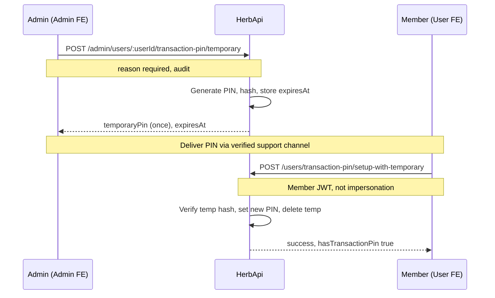

# Backend Request — Admin-Issued Temporary Transaction PIN (Member Recovery)

**Date:** 2026-10-16  
**From:** Admin FE / Member FE  
**Scope:** Support workflow when a **platform member** forgot their **4-digit transaction PIN**  
**Priority:** Medium–High  
**Status:** **Backend shipped** — Admin FE + Member FE integrated against this contract  
**Area:** Transaction PIN (`users` module) + admin user operations  

**Related docs:**

- [frontend-integration-admin-impersonation.md](./frontend-integration-admin-impersonation.md) — impersonation must **not** be used to set PIN; member completes recovery on their own session
- Member FE: `mlm-user.fe/docs/transaction-pin-api.md` — existing `set` / `change` / OTP `reset` flows
- Admin pattern reference: temporary admin login password (`POST /admin/admin-users/:id/reset-password`, `BACKEND_REQUEST_ADMIN_SET_USER_PASSWORD.md`)

---

## 1. Summary

**Product rule:**

1. An authorized admin **generates a temporary transaction PIN** for a member.
2. The temporary PIN is **valid only for a limited time** (TTL).
3. The member uses that temporary PIN **only** to **set a new permanent transaction PIN** (self-service on the member app).
4. The temporary PIN **must not** work for withdrawals, wallet transfers, Legacy cashout, or any other money action.

This is **separate from impersonation**. Impersonation remains view/support with blocked sensitive actions. Recovery is: **admin issues temp PIN → member logs in as themselves → completes setup**.

---

## 2. Problem

| Flow today | Limitation |
|------------|------------|
| Member OTP reset (`POST /users/transaction-pin/reset-request` + `reset`) | Requires member email access; support cannot assist when OTP fails |
| Admin impersonation | **Blocked** for all `/users/transaction-pin/*` routes (`IMPERSONATION_ACTION_BLOCKED`) |
| Admin sets member PIN directly | **Not desired** — admin must not know or choose the member’s permanent PIN |

**Gap:** Admin-assisted recovery with a **time-boxed recovery credential** the member uses once to choose a new PIN.

---

## 3. End-to-end flow



---

## 4. Credential model

| Credential | Storage | Used for |
|------------|---------|----------|
| **Permanent transaction PIN** | Hashed on user record (existing) | Withdrawals, transfers, Legacy cashout, etc. |
| **Temporary transaction PIN** | Separate record (hash + metadata) | **Only** `POST /users/transaction-pin/setup-with-temporary` |

**Rules:**

- At most **one active** temporary PIN per user. Issuing a new one **revokes** the previous (delete or mark revoked).
- Store **hash only** (same strength as permanent PIN hashing — e.g. bcrypt/argon2; never log or persist plaintext except transient response to admin once).
- On **successful** setup-with-temporary: delete temporary record; set permanent PIN; `hasTransactionPin = true`.
- On **expiry**: temporary PIN rejected; optional background job to purge expired rows.
- **Recommended on issue:** Invalidate the **current permanent PIN** immediately (clear hash / `hasTransactionPin = false`) so the member cannot keep using an old forgotten PIN and must complete recovery. Document this in admin UI copy.

**Temporary PIN format:** Exactly **4 numeric digits** (`^\d{4}$`), same as permanent PIN, unless product chooses 6 digits for lower brute-force risk — if 6 digits, document and align member/admin FE validation.

---

## 5. Persistence (suggested)

New table or equivalent, e.g. `user_transaction_pin_temporary`:

| Column | Type | Notes |
|--------|------|-------|
| `id` | uuid | PK |
| `user_id` | uuid | FK users, unique where `revoked_at IS NULL AND expires_at > now()` |
| `pin_hash` | string | |
| `issued_by_admin_id` | uuid | FK admin_users |
| `reason` | text | Required support note (min length e.g. 10) |
| `expires_at` | timestamptz | |
| `created_at` | timestamptz | |
| `revoked_at` | timestamptz | nullable; set on re-issue or admin revoke |
| `consumed_at` | timestamptz | nullable; set on successful setup |
| `failed_attempts` | int | default 0; lock after N failures |

Optional: `session_id` / `issue_id` for audit correlation.

---

## 6. Admin API

### 6.1 Issue temporary PIN

```http
POST /admin/users/:userId/transaction-pin/temporary
```

**Auth:** Admin Bearer JWT  

**Permission (new):** `users.transaction_pin.temporary` (recommended). Do **not** reuse `users.impersonate` alone.

**Path:** `userId` — platform member id (same as `POST /admin/users/:id/impersonate`).

**Request body:**

```json
{
  "reason": "Member verified via phone support ticket #4821",
  "validForMinutes": 60
}
```

| Field | Type | Required | Notes |
|-------|------|----------|-------|
| `reason` | string | **Yes** | Min length 10; stored for audit |
| `validForMinutes` | number | No | Default **60**; server **cap** e.g. 15–1440 (product config) |

**Behaviour:**

1. Validate member exists, is not deleted/banned per policy.
2. Revoke any existing active temporary PIN for this user.
3. Generate cryptographically secure random PIN (4 digits; reject weak patterns if desired, e.g. `0000`).
4. Persist hash + `expires_at` + `issued_by_admin_id` + `reason`.
5. **Recommended:** Clear existing permanent transaction PIN (`hasTransactionPin = false`).
6. Write audit event `ADMIN_TRANSACTION_PIN_TEMPORARY_ISSUED`.
7. **Optional:** Send member notification (email/SMS): “Support issued a temporary transaction PIN. If this wasn’t you, contact us immediately.” Do **not** include the PIN in email if admin is expected to read it to the member on phone (product choice).

**Success `201 Created`:**

```json
{
  "userId": "uuid",
  "username": "johndoe",
  "temporaryPin": "4829",
  "expiresAt": "2026-10-16T15:53:00.000Z",
  "validForSeconds": 3600,
  "hasTransactionPin": false
}
```

- `temporaryPin` is returned **once** in this response (same pattern as admin temporary login password). Subsequent GET must **not** reveal it.

**Errors:**

| Status | Code / message | When |
|--------|----------------|------|
| `400` | Validation | Missing/short `reason`, invalid TTL |
| `403` | Forbidden | Missing permission |
| `404` | Not found | Unknown user |
| `409` | — | Optional: block if user state disallows (e.g. suspended) |

---

### 6.2 Optional: Temporary PIN status (no secret)

```http
GET /admin/users/:userId/transaction-pin/temporary
```

**Auth:** Admin Bearer + `users.transaction_pin.temporary` (or `users.view` + same action permission).

**Success `200`:**

```json
{
  "active": true,
  "expiresAt": "2026-10-16T15:53:00.000Z",
  "issuedAt": "2026-10-16T14:53:00.000Z",
  "issuedByAdminId": "uuid",
  "consumedAt": null
}
```

If none active: `{ "active": false }`.

---

### 6.3 Optional: Revoke before expiry

```http
DELETE /admin/users/:userId/transaction-pin/temporary
```

**Body (optional):** `{ "reason": "Issued in error" }`  

**Audit:** `ADMIN_TRANSACTION_PIN_TEMPORARY_REVOKED`.

---

## 7. Member API

### 7.1 Set permanent PIN using temporary PIN

```http
POST /users/transaction-pin/setup-with-temporary
```

**Auth:** Member Bearer JWT (**platform user**, not admin).

**Impersonation:** **Must reject** with `403` and `error: IMPERSONATION_ACTION_BLOCKED` (same as other PIN routes). Member must complete this on their **own** login session.

**Request body:**

```json
{
  "temporaryPin": "4829",
  "newPin": "7391",
  "confirmNewPin": "7391"
}
```

| Field | Type | Required | Notes |
|-------|------|----------|-------|
| `temporaryPin` | string | **Yes** | `^\d{4}$` |
| `newPin` | string | **Yes** | `^\d{4}$`; must not equal `temporaryPin` (recommended) |
| `confirmNewPin` | string | **Yes** | Must match `newPin` |

**Behaviour:**

1. Load active non-expired, non-revoked temporary record for JWT user.
2. Compare `temporaryPin` to hash (constant-time); increment `failed_attempts` on failure; lock after **5** failures (configurable) for **15 minutes**.
3. Validate `newPin` / `confirmNewPin`.
4. Set permanent PIN hash; `hasTransactionPin = true`.
5. Mark temporary row consumed (`consumed_at`) or delete.
6. Audit: `USER_TRANSACTION_PIN_SET_VIA_TEMPORARY` (user id, temp issue id; no PIN values).

**Success `200`:**

```json
{
  "success": true,
  "message": "Your transaction PIN has been set successfully.",
  "hasTransactionPin": true
}
```

**Errors:**

| Status | Message / code | When |
|--------|----------------|------|
| `400` | Validation | PIN format, mismatch confirm |
| `400` | Incorrect temporary PIN | Wrong temp PIN (generic message; do not leak expiry vs wrong) |
| `403` | `IMPERSONATION_ACTION_BLOCKED` | Impersonation JWT |
| `404` | No active temporary PIN | None issued or expired/revoked |
| `429` | Too many attempts | Lockout after failed verifications |

---

## 8. What temporary PIN must NOT do

Explicitly **reject** temporary PIN on all existing endpoints that accept `pin` in the body, including but not limited to:

- `POST /withdrawals/request`
- `POST /wallets/transfer` (if PIN-gated)
- `POST /wallets/fund-transfer`
- Legacy cashout / PIN-gated Legacy routes
- `POST /users/transaction-pin/verify`
- `PUT /users/transaction-pin/change`
- `POST /users/transaction-pin/set` (use dedicated setup-with-temporary instead)
- OTP `POST /users/transaction-pin/reset` (unchanged; separate flow)

Only **`setup-with-temporary`** validates the temporary credential.

---

## 9. RBAC

Add permission:

| Key | Label | Module |
|-----|-------|--------|
| `users.transaction_pin.temporary` | Issue temporary transaction PIN | Users |

Seed to appropriate support / super-admin roles. Admin FE will gate the user-detail action on this key.

---

## 10. Audit log

| Event | Actor | Payload (no secrets) |
|-------|-------|----------------------|
| `ADMIN_TRANSACTION_PIN_TEMPORARY_ISSUED` | admin id | target user id, reason, expiresAt, issue id |
| `ADMIN_TRANSACTION_PIN_TEMPORARY_REVOKED` | admin id | target user id, reason |
| `USER_TRANSACTION_PIN_SET_VIA_TEMPORARY` | user id | issue id, admin id who issued |

Never log `temporaryPin`, `newPin`, or hashes.

---

## 11. Configuration (env)

| Variable | Example | Purpose |
|----------|---------|---------|
| `TRANSACTION_PIN_TEMP_DEFAULT_MINUTES` | `60` | Default TTL |
| `TRANSACTION_PIN_TEMP_MAX_MINUTES` | `1440` | Max TTL admin can request |
| `TRANSACTION_PIN_TEMP_MIN_MINUTES` | `15` | Min TTL |
| `TRANSACTION_PIN_TEMP_MAX_ATTEMPTS` | `5` | Failed verify before lockout |
| `TRANSACTION_PIN_TEMP_LOCKOUT_MINUTES` | `15` | Lockout duration |

---

## 12. Coexistence with OTP reset

Keep existing member self-service:

- `POST /users/transaction-pin/reset-request`
- `POST /users/transaction-pin/reset`

Temporary admin PIN is an **additional** support path, not a replacement. If both are active, **consuming** setup-with-temporary should invalidate pending OTP reset tokens for transaction PIN (optional, recommended).

---

## 13. Acceptance criteria

- [ ] Admin with permission can issue temp PIN; receives plaintext **once**; audit row created.
- [ ] Second issue revokes first; only latest temp PIN works until expiry.
- [ ] Expired temp PIN cannot complete setup-with-temporary.
- [ ] Member completes setup on **non-impersonation** session; `hasTransactionPin` true afterward.
- [ ] Temp PIN fails on withdrawal/transfer/verify/change.
- [ ] Impersonation JWT gets `403 IMPERSONATION_ACTION_BLOCKED` on setup-with-temporary.
- [ ] After 5 wrong temp attempts, lockout applies.
- [ ] `GET /users/me` reflects `hasTransactionPin` correctly after issue (false if permanent cleared) and after setup (true).
- [ ] Admin without permission gets `403`.

---

## 14. Frontend follow-up (out of scope for this doc)

| App | Work |
|-----|------|
| Admin FE | User detail action + reason modal + one-time PIN result modal (mirror admin temp password UX) |
| Member FE | Profile section “Set PIN with temporary code”; `UserService.setupTransactionPinWithTemporary()` |
| Docs | Extend `transaction-pin-api.md` § new endpoint when shipped |

---

## 15. Open questions for product

1. **Invalidate permanent PIN on issue?** (Recommended: yes.)
2. **Deliver PIN:** Admin reads to member only vs also send SMS/email to member.
3. **4 vs 6 digit** temporary PIN.
4. **Block issue** for users in specific statuses (suspended, unpaid, etc.).

---

**HerbApi pointer (for implementers):** Add module methods alongside existing transaction-pin service; wire admin controller under `admin/users`; enforce impersonation guard on member controller same as existing PIN routes.
